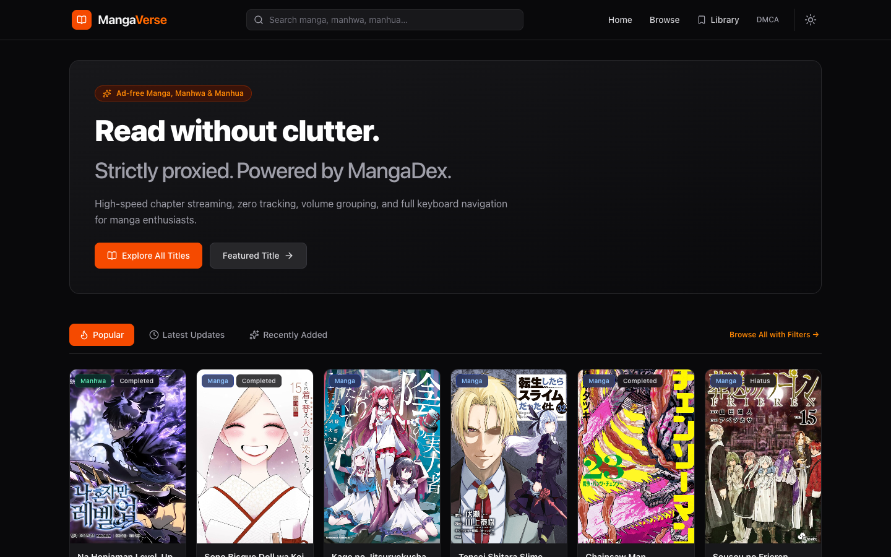
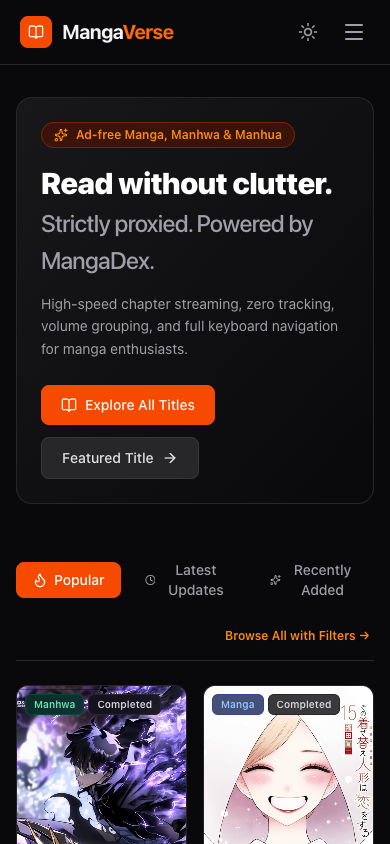
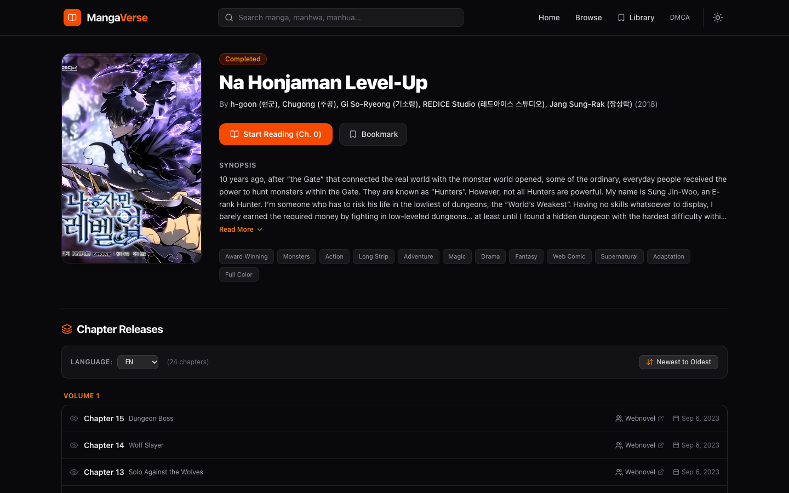
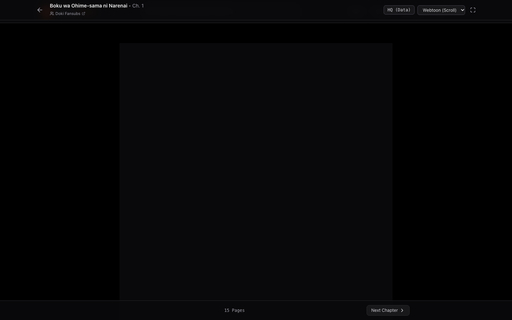

# MangaVerse (mangadex-reader)

A clean, fast, ad-free reader for manga, manhwa and manhua, powered by the public [MangaDex API](https://api.mangadex.org/docs/). It runs on Next.js and works on both desktop and mobile.

<p align="center">
  
</p>

## Features

- **Browse and discover:** a home page and a browse page with a filter drawer for narrowing results
- **Series pages:** cover, details and a full chapter list for each title
- **Chapter reader:** three reading modes (webtoon, paged right-to-left, paged left-to-right) and a data-saver option for lower bandwidth
- **Library:** bookmarks, reading history and preferences, stored in the browser's local storage with no account needed
- **Light and dark themes:** a theme toggle, with dark as the default
- **Responsive layout:** every main page is designed for desktop and mobile
- **Content filtering:** safe and suggestive ratings by default, erotica only by opt-in, and pornographic content never requested or shown

## Screenshots

| Page | Desktop | Mobile |
|---|---|---|
| Home |  |  |
| Series |  |  |
| Reader |  |  |

## Tech stack

| Area | Tools |
|---|---|
| Framework | Next.js 15 (App Router), React 19 |
| Styling | Tailwind CSS 4, PostCSS |
| Icons | lucide-react |
| Testing | Vitest |
| Data source | MangaDex public API |

## How it works

The browser never talks to MangaDex directly. All requests go through API routes in this app (`/api/*`), which call MangaDex on the server. This keeps the app within MangaDex's API rules and gives it one place to control traffic.

- **Rate limiting:** a token bucket keeps general API calls near 5 requests per second, a sliding window limits the stricter `/at-home/server` endpoint to 35 requests per minute, and a concurrency cap of 12 limits simultaneous cover and page image streams
- **Request deduplication:** identical requests that are already in flight share one upstream call
- **Backoff:** a `429 Too Many Requests` response pauses upstream traffic and respects the `Retry-After` header
- **Clean upstream requests:** a descriptive `User-Agent` is always sent, and the `Via` header, cookies and authorization headers are removed
- **Caching:** configured lifetimes for tags, manga details, chapter feeds, covers and pages
- **MangaDex@Home reporting:** image loads from third-party nodes are reported back to `api.mangadex.network`, as the API docs ask
- **Blocklist:** titles listed in `config/blocklist.json` are excluded

## Project structure

```
mangadex-reader/
├── config/
│   ├── site.js              # site name, API endpoints, rate limits, cache TTLs, content rules
│   └── blocklist.json       # titles excluded from results
├── screenshots/             # images used in this README
├── src/
│   ├── app/
│   │   ├── api/             # server proxy routes (manga, chapter, cover, page, at-home)
│   │   ├── browse/          # browse and filter page
│   │   ├── library/         # bookmarks and reading history
│   │   ├── manga/[id]/      # series detail page
│   │   ├── read/[chapterId]/# chapter reader
│   │   └── takedown/        # takedown request page
│   ├── components/          # Navbar, MangaGrid, MangaCard, ChapterList, FilterDrawer, ReaderView, ThemeToggle, Footer
│   └── lib/                 # API helpers, rate limiter, request queue, proxy client, storage, theme
└── tests/                   # Vitest unit tests
```

## Getting started

### Requirements

- Node.js 18.18 or later
- npm

### Install and run

```bash
git clone https://github.com/Mr-cmd-pip/mangadex-reader.git
cd mangadex-reader
npm install
npm run dev
```

Then open [http://localhost:3000](http://localhost:3000).

### Set your User-Agent before deploying

MangaDex requires every client to send a descriptive `User-Agent` that includes a contact email or repository URL. Open `config/site.js` and replace the placeholder in `upstreamUserAgent`:

```js
upstreamUserAgent: 'MangaVerse/0.1.0 (https://github.com/Mr-cmd-pip/mangadex-reader)',
```

### Scripts

| Command | What it does |
|---|---|
| `npm run dev` | Start the development server |
| `npm run build` | Create a production build |
| `npm start` | Run the production build |
| `npm test` | Run the Vitest test suite once |

## Testing

Unit tests live in `tests/` and cover the rate limiter, the proxy request headers, the theme logic and the image URL builder.

```bash
npm test
```

## Disclaimer

This project is not affiliated with or endorsed by MangaDex. All manga content and metadata come from the MangaDex API and belong to their respective creators and uploaders. Takedown requests can be made through the app's takedown page.
